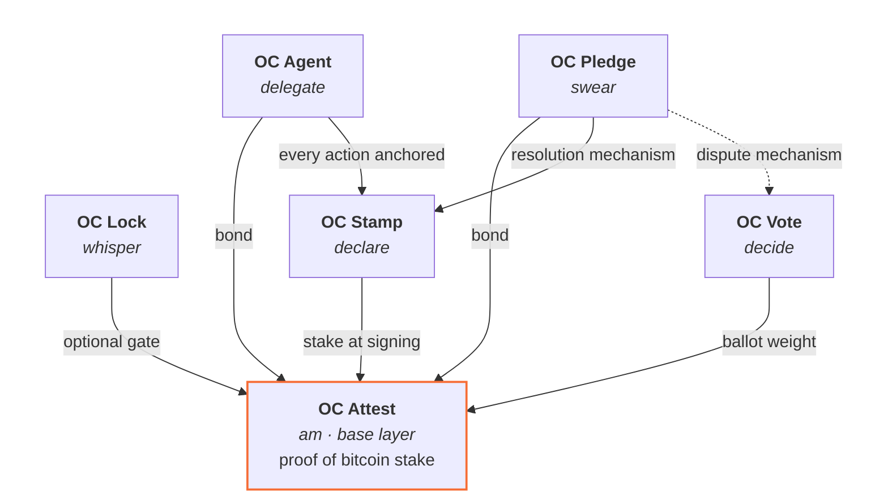

export const metadata = {
    title: 'orangecheck documentation',
    description:
        'orangecheck is one account, with Bitcoin behind it. Underneath are six open protocols (Attest, Lock, Stamp, Vote, Agent, Pledge). Docs for signing people in with the account, its developer API, the protocols and the charter.',
};

# Overview

**orangecheck is one account, with Bitcoin behind it**
([ochk.app](https://ochk.app)). Underneath are six open protocols.

Building an app? [Sign people in](/me/quickstart) with the account: it is free,
and paying your users is optional. Working with the protocols? They share one
canonical message format, one BIP-322 signing primitive and one set of Nostr
conventions. Learn that layer once; each protocol adds a small layer on top.

## The family

Six verbs of sovereign sociality: _am, whisper, decide, declare, delegate,
swear_.

<ProtocolGrid link="docs" className="not-prose my-6 lg:grid-cols-2" />

OC Attest is the **base layer** — every other sibling can optionally reference
an Attest proof as a "stake at signing" signal. The other five siblings are
**peers**: none depends on the others at the protocol level.

## How they compose

Eight real composition arrows across six protocols: every peer can pin its
artifacts to Attest stake; Pledge resolves through Stamp and disputes through
Vote; every Agent action is itself a Stamp. None of these compositions is
required — but each one is what turns six small protocols into a single
substrate.

## The product and the showcase apps

The protocols are open and free to self-host. On them orangecheck builds one
product, ochk.app, and showcase apps: full, working apps whose other job is to
show a protocol doing real work. They use the same envelopes, the same BIP-322
signing and the same anchor pipeline: consumers of the protocols, not extensions
to them.

| App                      | What it is                                                                                                                                                                              |
| ------------------------ | --------------------------------------------------------------------------------------------------------------------------------------------------------------------------------------- |
| **[ochk.app](/me)**      | One account, with Bitcoin behind it, at [ochk.app](https://ochk.app). Apps that choose to pay their users pay them in sats. orangecheck holds earned sats while payouts are in testing. |
| **[OC Vault](/vault)**   | A password manager that cannot read your data. Secrets are sealed on your device; orangecheck stores ciphertext only.                                                                   |
| **[OC Chat](/chat)**     | End-to-end-encrypted messaging where your Bitcoin address is the inbox. No phone number, and messages open only on your devices.                                                        |
| **[OC Cosign](/cosign)** | Get behind a builder: join as a co-founder, or back them with sats that settle peer-to-peer.                                                                                            |

Each of them operates under the [charter](/charter) — eight commitments that
bind every orangecheck surface (no token, custody you can move out of, the
protocol stays open, audit verifies without us, and so on).

## How these docs are organized

- **[Getting started](/getting-started/which-protocol)** — land here first.
  Decision tree across the six protocols, plus a running integration in under
  five minutes.
- **[Ecosystem](/ecosystem)** — the plumbing every protocol inherits. The
  canonical message format, BIP-322 signing, Nostr kind-30078, conformance
  vectors, and the shared security model. Written once; never duplicated.
- **Per-protocol sections** — one each for Attest, Lock, Stamp, Vote, Agent,
  Pledge. Each follows the same shape: overview → how it works → concepts → API
  → guides. Pattern-match once; navigate them all.
- **Per-app sections** — one each for [ochk.app](/me), [OC Vault](/vault),
  [OC Chat](/chat) and [OC Cosign](/cosign): what it is, how to use it, and what
  it trusts.
- **[SDKs](/sdk)** — every published `@orangecheck/*` package, mapped to which
  protocol or product it serves.
- **[Charter](/charter)** — single source of truth for the eight company
  commitments. Every product subdomain links here.
- **[Reference](/reference/faq)** — FAQ and glossary.

## Where the authoritative bits live

|                           | Repo                                                                                                         |
| ------------------------- | ------------------------------------------------------------------------------------------------------------ |
| Canonical protocol spec   | [`oc-attest-protocol`](https://github.com/orangecheck/oc-attest-protocol) (MIT)                              |
| Reference implementations | [`oc-packages`](https://github.com/orangecheck/oc-packages) (MIT) — one monorepo for every published package |
| OC Lock spec              | [`oc-lock-protocol`](https://github.com/orangecheck/oc-lock-protocol)                                        |
| OC Stamp spec             | [`oc-stamp-protocol`](https://github.com/orangecheck/oc-stamp-protocol)                                      |
| OC Vote spec              | [`oc-vote-protocol`](https://github.com/orangecheck/oc-vote-protocol)                                        |
| OC Agent spec             | [`oc-agent-protocol`](https://github.com/orangecheck/oc-agent-protocol)                                      |
| OC Pledge spec            | [`oc-pledge-protocol`](https://github.com/orangecheck/oc-pledge-protocol)                                    |
| This site                 | `oc-docs`                                                                                                    |

## Conventions

- Short code snippets are runnable as-is. Longer ones link to a full working
  example in
  [`oc-packages/EXAMPLES.md`](https://github.com/orangecheck/oc-packages/blob/main/EXAMPLES.md).
- "Attestation" (lowercase) refers specifically to an **OC Attest** signed
  proof. Lock envelopes, Stamp envelopes, Vote ballots, etc. are not called
  attestations.
- Every protocol ships a spec repo and a reference impl. If the two disagree,
  **the spec is authoritative** and the impl is the bug.

## Start somewhere

- [**Which protocol do I need?**](/getting-started/which-protocol) — 60-second
  decision tree
- [**Sign people in**](/me/quickstart) — the account quickstart: sign-in first,
  then paying your users if you want it
- [**Protocol quickstarts**](/getting-started/quickstart) — one per protocol
- [**Ecosystem concepts**](/ecosystem) — learn the shared layer once
- [**OC Attest overview**](/attest) — the base-layer protocol
- [**ochk.app overview**](/me) — one account, with Bitcoin behind it
- [**Charter**](/charter) — what orangecheck commits to, in writing
