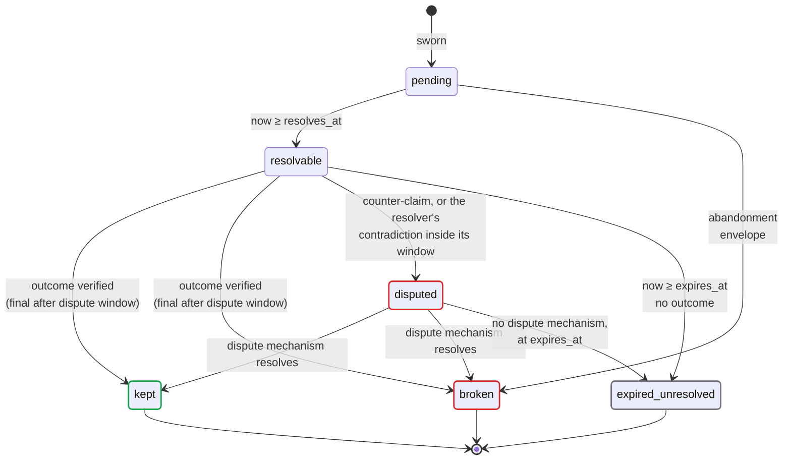

export const metadata = {
    title: 'OC Pledge — State machine',
    description:
        'Every pledge is in one of six states. Transitions are pure functions of (envelope, outcome, time, public state). Two verifiers with the same inputs produce the same classification.',
};

# State machine

Every pledge is in **exactly one** of these states at any given time:

| State                | Meaning                                                                                               |
| -------------------- | ----------------------------------------------------------------------------------------------------- |
| `pending`            | Sworn, before `resolves_at`.                                                                          |
| `resolvable`         | Past `resolves_at`, within `expires_at`, no outcome published yet.                                    |
| `kept`               | Outcome published, outcome = kept. Provisional until the dispute window passes, then final.           |
| `broken`             | Outcome published, outcome = broken (provisional until the dispute window passes), or an abandonment. |
| `disputed`           | A counter-claim before `expires_at`, or the resolver's own contradiction inside its window.           |
| `expired_unresolved` | Past `expires_at` with no consistent outcome, or a dispute with no dispute mechanism.                 |

State transitions are **pure functions** of
`(pledge envelope, outcome envelope or absence, current time, relevant public state)`.
Two verifiers with the same inputs produce the same classification. This is a
**conformance requirement** — disagreement on state is a protocol bug.

An outcome whose `resolved_at` is later than now does not count yet: until then
the pledge classifies as if it had none.

## Transitions

**Abandonment counts as broken** — there is no separate abandoned state.
Refusing the "honorable exit" classification preempts the race-to-abandon attack
where swearers dodge a foreseeable break by admitting it slightly earlier.

## What "verified" means in `resolvable → kept|broken`

For deterministic mechanisms (`chain_state`, `nostr_event_exists`,
`stamp_published`, `http_get_hash`, `dns_record`, `vote_resolves`): the verifier
re-computes the outcome envelope from public state. Byte-equal to the published
one ⇒ verified. For `vote_resolves`, that public state is the named OC Vote
poll's tally, checked against the pledge's threshold; the outcome is unsigned.

For `counterparty_signs`: a BIP-322 signature check under the counterparty's
address.

## Bond verification at every transition

A pledge with a bond reference whose underlying OC Attest UTXO is spent
mid-pledge is **not** auto-reclassified by the protocol — that's a
verifier-policy decision (see
[SPEC §8](https://github.com/orangecheck/oc-pledge-protocol/blob/main/SPEC.md)).
The protocol surfaces `E_BOND_SPENT` as an error code; an integrator choosing
strict policy treats a spent bond as an automatic break, while a lenient one
treats it as informational. Refusing automatic reclassification preserves the
[no-slashing rule](/pledge/enforcement-by-exposure) — the protocol never _does_
anything to a swearer's status; it only _exposes_ the facts.

## Dispute window

Each outcome envelope carries its own `dispute_window_ends_at`, written by
whoever writes the outcome. The pledge has no dispute-window field, and the
protocol sets no default length.

`classifyState` returns an outcome as soon as it is in force, inside the window
too. A verifier that wants to tell a provisional outcome from a final one
compares `now` with `dispute_window_ends_at` itself.

The earliest settling outcome's window bounds only the resolver's own later
contradictions: one dated after it does not count, and the earliest settling
outcome stands. On a `counterparty_signs` pledge, a swearer counter-claim
contradicts whenever it is dated before `expires_at`, whatever window the
counterparty set. Every date in an outcome is its signer's own claim, so the
counterparty's window cannot shut the swearer out. A counter-claim never settles
the pledge. `classifyState` reads every outcome earliest first, whatever order
you pass them in. A dispute on a pledge that names a dispute mechanism stays
`disputed`, referred to that mechanism; on one that names none, it times out to
`expired_unresolved` at `expires_at`.

## The `expired_unresolved` class is intentional

A pledge with no outcome by `expires_at` is **not** automatically broken. It's a
third outcome class, queryable separately. The reason: a pledge with
`counterparty_signs` resolution where the counterparty just never shows up is
informational about _the counterparty's_ behavior, not the swearer's. Conflating
it with `broken` would let lazy counterparties break pledges by silence.

Verifiers building gates can compose any policy they want — count
`expired_unresolved` as broken for one address class, ignore it for another. The
protocol surfaces the raw fact.
