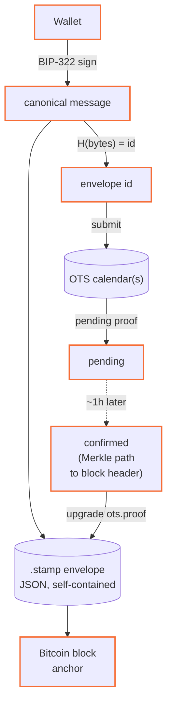

export const metadata = {
    title: 'Protocol walkthrough',
    description:
        'Narrative companion to the spec. If you want the normative rules, read the spec. If you want to understand why and how, read this.',
};

export const meta = {
    title: 'Protocol walkthrough — OC Stamp docs',
    description: 'Five narrative flows through the common OC Stamp use cases.',
};

# Protocol walkthrough

Narrative companion to the [spec](/stamp/spec). If you want the normative rules,
read the spec. If you want to understand _why_ and _how_, read this.

## The mental model



Every stamp is **one signing ceremony, one calendar submission, one later
upgrade**. The envelope is self-contained: canonical message, BIP-322 signature,
OTS proof, optional stake context. Verification is a pure function of envelope +
Bitcoin headers.

## Flow 1 — Alice stamps a blog post

1. Alice writes a Markdown post. 12,843 bytes.
2. Her browser computes `sha256(bytes)` locally — content never leaves her tab.
3. Client builds the canonical message (six lines, `oc-stamp:v1`
   domain-separated).
4. Client derives `id = sha256(canonical_message)` and shows her the message
   beside it.
5. Her wallet signs the hex `id` via BIP-322. One prompt. The client submits the
   id to two OTS calendars.
6. Client assembles the envelope: v, kind, id, content (hash + length + mime +
   ref), signer, signed_at, stake (null), ots (pending), sig.
7. About an hour later, an OTS calendar anchors the root to a Bitcoin block. The
   upgraded proof contains the Merkle path from id up to the block header. Any
   client can fetch and replace `ots.proof`.
8. Alice ships `blogpost.md.stamp` alongside her post.

A year later, Bob reads the post offline on a plane. He loads the `.stamp`, his
tool reconstructs the canonical message, re-derives the id, verifies the BIP-322
signature, walks the OTS proof to the Bitcoin header Merkle root, and confirms
the bytes he has match `content.hash`. No network required.

## Flow 2 — Commit-signing with `git-stamp`

Current state of tag signing: GPG keys nobody audits, keyservers nobody trusts.
Developers already have Bitcoin wallets.

```
$ npm i -g @orangecheck/stamp-cli
$ git-stamp tag v2.1.0 --addr bc1qalice…

This stamp commits to:
────────────────────────────────────────────────────────────
oc-stamp:v1
address: bc1qalice…
content_hash: sha256:01b3286f…
content_length: 128
content_mime: application/x-git-tag
signed_at: 2026-04-24T18:30:00Z
────────────────────────────────────────────────────────────

Sign this id with bc1qalice… (BIP-322):

c62fe0cabadd5e7953c24147e6f895f26c1d483db832801e1661aa7926c735fb

paste signature (base64): …
ok: true
tag: v2.1.0
id: c62fe0ca…
ots: pending
written: .git/stamps/v2.1.0.stamp
```

The content is the tag name, the tag's object id and its tree id, so changing
any of them breaks the stamp. Anyone with the repository and the stamp file runs
`git-stamp verify v2.1.0`, or `--require-anchor` once the anchor is confirmed:
authorship, priority and the tree are all checked, no GPG keyserver involved.

## Flow 3 — Sybil-gated publishing feed

A platform accepts submissions from anyone but wants a stake signal. The stamp
names the author; the platform re-checks the author's own attestation against
the chain when it verifies.

```ts
import type { StampEnvelope } from '@orangecheck/stamp-core';

import { verifySignature } from '@orangecheck/bip322';
import { checkStake, verify } from '@orangecheck/stamp-core';

async function acceptSubmission(envelope: StampEnvelope, bytes: Uint8Array) {
    const r = await verify({
        envelope,
        content: bytes,
        verifyBip322: async (msg, sig, addr) => verifySignature(addr, msg, sig),
    });
    if (!r.ok) return { accepted: false, error: r.code };
    if (!r.envelope.stake) return { accepted: false, error: 'no_stake' };

    const id = r.envelope.stake.attestation_id;
    const att = await fetch(`https://attest.ochk.io/api/check?id=${id}`).then(
        (res) => res.json()
    );
    const stake = checkStake(r.envelope, att.ok ? att : null, {
        minSats: 100_000,
        minDays: 30,
    });
    if (!stake.ok) return { accepted: false, error: stake.message };
    return { accepted: true };
}
```

`stake` is not signed, so the address check is what keeps someone else's bond
from counting. Requiring 30 days unspent means the coins sat for a month, which
defeats stake farmed in the last week.

## Flow 4 — Legal self-notarization

Wills, assignment agreements, IP disclosures, NDAs. A notary's job is "this
document existed, signed by this person, on this date." OC Stamp produces that
cryptographically:

- **Authorship**: BIP-322 bound to a provable Bitcoin address.
- **Priority**: confirmed OTS anchor in a specific Bitcoin block, adversarially
  public.
- **Tamper-evidence**: `content.hash` commits to the bytes; any edit invalidates
  the id and the signature.

In jurisdictions that recognize digital signatures (Federal Rules of Evidence
901/902 in the US, eIDAS in the EU), a BIP-322-signed PDF with a confirmed OTS
anchor is admissible.

## Flow 5 — DAO proposal with durable provenance

A proposal is a Markdown doc. Today it lives in a forum thread whose authorship
is whoever clicked "post." With OC Stamp, the proposal author includes a
`.stamp` envelope carrying _who proposed and when_ — and the DAO's later vote
(via [OC Vote](https://vote.ochk.io)) can reference the stamp id.

## What's NOT in the protocol

- **Our own timestamping layer.** OTS works. Peter Todd built it correctly.
- **A proprietary Nostr kind.** We use 30083 in the orangecheck family range
  (30078 for attestations and lock device records, 30080–30082 for vote). No
  overloading.
- **Keyservers we operate.** Envelopes are self-contained; directory is
  optional.
- **Custody of signer keys.** Never. The wallet the user already holds is the
  identity.
- **Making OTS non-optional for signing.** A signed-but-unanchored envelope is a
  legitimate artifact; any later client can upgrade it.

## What's layered from orangecheck

- **Optional stake reference** in `stake.attestation_id`. Composes with
  [`@orangecheck/gate`](https://www.npmjs.com/package/@orangecheck/gate) on the
  consumer side.
- **Identity continuity** — the same Bitcoin address the user holds an
  orangecheck attestation under, an OC Lock device record under, is the stamp
  signer.

## Where to go next

- [Specification](/stamp/spec) — normative rules.
- [Envelope format](/stamp/envelope) — wire schema.
- [OpenTimestamps integration](/stamp/ots) — the anchor flow in detail.
- [Security model](/stamp/security) — threat model and trust assumptions.
